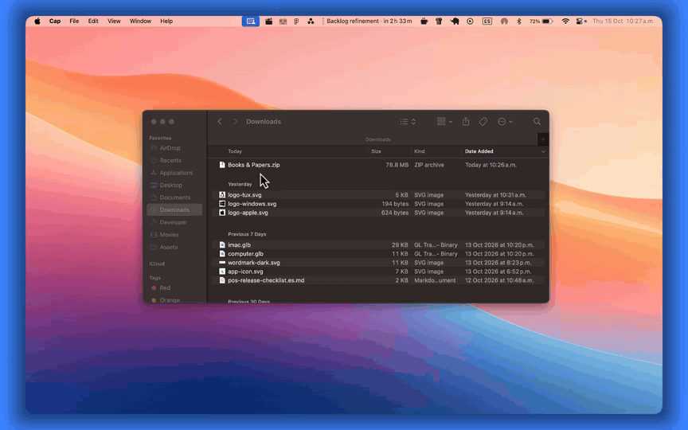

<div align="center">
  <picture>
    <source media="(prefers-color-scheme: dark)" srcset="docs/assets/wordmark-dark.svg" />
    <source media="(prefers-color-scheme: light)" srcset="docs/assets/wordmark-light.svg" />
    
  </picture>

  <p><strong>Files, anywhere. Instantly.</strong></p>

  <p>
    Peer-to-peer file sharing for macOS, Windows and Linux.<br />
    Select your files, hit a shortcut, send.
  </p>

  <p>
    <a href="https://getzephyr.app">Website</a> ·
    <a href="https://getzephyr.app/downloads">Download</a> ·
    <a href="https://discord.gg/E88TZXsPjN">Discord</a> ·
    <a href="https://bsky.app/profile/zephyrapp.bsky.social">Bluesky</a>
  </p>
</div>

<p align="center">
  
</p>

---

Zephyr sends files straight from one device to another. Devices on your network show up on their own, and you can add anyone else in the world as a contact. On macOS and Windows it lives in your system: select files in Finder or File Explorer, press the share shortcut and pick who gets them. No app to open, nothing to drag.

> [!NOTE]
> Zephyr is in early development. Expect rough edges, and expect things to change between releases. If something breaks, please [open an issue](https://github.com/dead-pxl-society/zephyr/issues) or tell us on [Discord](https://discord.gg/E88TZXsPjN).

## Features

- **Share from anywhere.** Select files in Finder or File Explorer and press a shortcut. On Linux, the shortcut opens Zephyr's window and you drop your files in.
- **Nearby and worldwide.** Devices on your local network are found automatically. Anyone else is just a contact away.
- **Personal devices.** Pair your own computers once and they trust each other: no accept prompts between them.
- **Clipboard sync.** Copy text or files (up to 25 MB by default) on one device and paste them on another, across macOS, Windows and Linux.
- **Private by design.** Every transfer is end-to-end encrypted and goes directly between devices. When a firewall blocks the direct path, a relay passes the encrypted data along without being able to read it. No account, nothing stored online.

Built with [Tauri](https://tauri.app) and [Iroh](https://iroh.computer).

## Install

Download the latest release from [getzephyr.app/downloads](https://getzephyr.app/downloads).

| Platform     | Download                                                                                                                                                                                                                                                                       | Architecture  |
| ------------ | ------------------------------------------------------------------------------------------------------------------------------------------------------------------------------------------------------------------------------------------------------------------------------ | ------------- |
| macOS 10.15+ | [`.dmg`](https://cdn.crabnebula.app/download/litsdm/zephyr/latest/platform/dmg-aarch64)                                                                                                                                                                                        | Apple Silicon |
| macOS 10.15+ | [`.dmg`](https://cdn.crabnebula.app/download/litsdm/zephyr/latest/platform/dmg-x86_64)                                                                                                                                                                                         | Intel         |
| Windows      | [Installer (`.exe`)](https://cdn.crabnebula.app/download/litsdm/zephyr/latest/platform/nsis-x86_64)                                                                                                                                                                            | x64           |
| Linux        | [AppImage](https://cdn.crabnebula.app/download/litsdm/zephyr/latest/platform/appimage-x86_64) · [`.deb`](https://cdn.crabnebula.app/download/litsdm/zephyr/latest/platform/debian-x86_64) · [`.rpm`](https://cdn.crabnebula.app/download/litsdm/zephyr/latest/platform/rpm-x86_64) | x64           |
| Linux        | [AppImage](https://cdn.crabnebula.app/download/litsdm/zephyr/latest/platform/appimage-aarch64) · [`.deb`](https://cdn.crabnebula.app/download/litsdm/zephyr/latest/platform/debian-aarch64) · [`.rpm`](https://cdn.crabnebula.app/download/litsdm/zephyr/latest/platform/rpm-aarch64) | ARM64         |

There's no native build for Windows on ARM yet.

## Quick start

1. **Open Zephyr.** A short onboarding walks you through the basics. After that, Zephyr stays in the background.
2. **Send files.** Select files or folders in Finder or File Explorer, press the share shortcut and pick a device. On Linux, the shortcut brings up Zephyr's window and you drop your files in. The first time you share on macOS, you'll be asked to let Zephyr control Finder. Allow it so Zephyr can see what you selected.
3. **Receive files.** Incoming shares show up as a notification. Accept or decline with a shortcut, without opening the app.
4. **Pair your own devices.** Choose **Add as personal device** on one of your nearby devices and confirm with the 6-digit pairing code. Paired devices skip the accept prompt and sync your clipboard. Text syncs by default; turn on file syncing in Settings.
5. **Add a contact.** For anyone outside your network, swap contact tickets. Copy yours from the profile menu at the bottom left, and paste theirs under **Add contact**.

### Default shortcuts

| Action                           | macOS | Windows & Linux |
| -------------------------------- | ----- | --------------- |
| Share selected files             | ⌃⌘Z   | Ctrl+Alt+Z      |
| Receive from clipboard           | ⌃⌘R   | Ctrl+Alt+R      |
| Accept the latest incoming share | ⌃⌘A   | Ctrl+Alt+A      |
| Decline the latest incoming share | ⌃⌘N   | Ctrl+Alt+N      |

You can change any of them in Settings.

## How it works

Zephyr is built on [iroh](https://iroh.computer), which finds devices and connects them to each other.

- **Identity.** Each device creates its own key pair the first time it runs. The public key, called the endpoint ID, is the device's address. There are no accounts and no central user list.
- **Encryption.** Every connection is QUIC, encrypted with TLS 1.3 and authenticated with those keys. Only the device on the other end can read what you send. Transfers use [iroh-blobs](https://github.com/n0-computer/iroh-blobs), which checks every file against its BLAKE3 hash as it arrives.
- **Nearby devices.** On your local network, devices announce themselves over mDNS and appear automatically. You can turn this off with **Disable local discovery**.
- **Everyone else.** Each device keeps a connection to a home relay. To reach a contact, Zephyr connects through their relay first, then uses hole punching to open a direct connection. Once that works, the relay drops out. If a firewall blocks every direct path, data keeps flowing through the relay.
- **What a relay sees.** Relays forward encrypted packets based on the endpoint ID alone and can't decrypt them. They do see the IP addresses and endpoint IDs of both devices, and how much data passes and when. Official builds use dedicated relays that n0 runs for Zephyr, separate from its public ones. [Builds from source](#build-from-source) use n0's public relays.
- **Finding contacts again.** So contacts can still reach you after your network changes, each device publishes a signed record with its endpoint ID and home relay to n0's DNS server (`dns.iroh.link`). The record contains no IP addresses.
- **Contact tickets.** A ticket holds your endpoint ID, your home relay and your current IP addresses. Sharing it is like sharing your IP address, so only give it to people you want to hear from.

## Build from source

> [!NOTE]
> Builds from source connect through [n0's public relays](https://www.iroh.computer/docs/concepts/relay) instead of the dedicated ones official builds use. To use your own relays, set `ZEPHYR_RELAYS` to a comma-separated list of relay URLs when you build.

### Prerequisites

- [Rust](https://rustup.rs) (stable)
- [Node.js](https://nodejs.org) 22 and [pnpm](https://pnpm.io)
- The [Tauri prerequisites](https://tauri.app/start/prerequisites/) for your platform
- Clang, which RocksDB needs at build time. It comes with the Xcode command line tools on macOS. On Windows, install [LLVM](https://releases.llvm.org) and set `LIBCLANG_PATH` to its `bin` folder if it isn't found automatically.

On Debian or Ubuntu, this covers the Tauri prerequisites and Clang:

```sh
sudo apt install libwebkit2gtk-4.1-dev libgtk-3-dev libayatana-appindicator3-dev \
  librsvg2-dev libxdo-dev libssl-dev build-essential curl wget file patchelf \
  xdg-utils clang libclang-dev
```

### Run and build

```sh
pnpm install
pnpm tauri dev
```

To build installable bundles, turn off the signed updater artifacts, which need the release signing key:

```sh
pnpm tauri build --config '{"bundle":{"createUpdaterArtifacts":false}}'
```

The bundles end up in `src-tauri/target/release/bundle`. The first build might take a while.

## Contributing

Issues and pull requests are welcome. For bigger changes, please open an issue or bring it up on [Discord](https://discord.gg/E88TZXsPjN) first so we can talk it through.

## License

Zephyr is licensed under the [Apache License 2.0](LICENSE).
